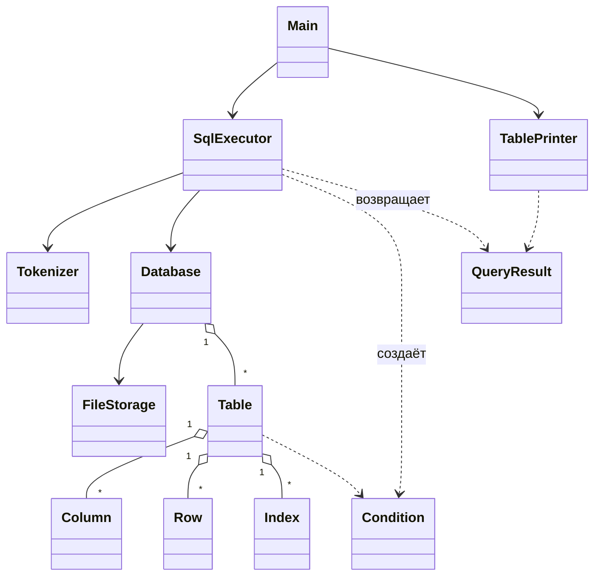
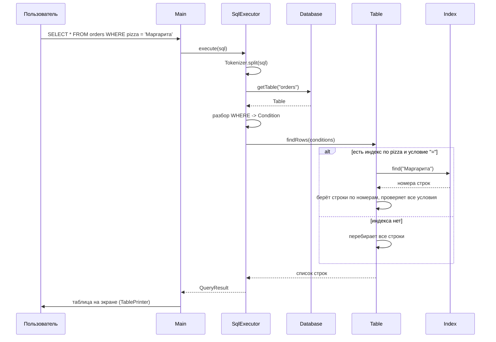

# PizzaDB — упрощённая СУБД на Java

Учебный проект: маленькая база данных со своим SQL-подобным языком запросов.
Предметная область — **пиццерия** (клиенты и их заказы).

Выполнили: Роман Голованов, Роман Ильин.

## Что умеет

- Таблицы с типами `INT`, `DOUBLE`, `STRING`, `DATE`, `BOOLEAN`, значение `NULL`.
- Первичный ключ (один столбец на таблицу) и связь между таблицами по внешнему ключу (`REFERENCES`).
- Запросы: `CREATE TABLE`, `DROP TABLE`, `INSERT INTO`, `SELECT`, `UPDATE`, `DELETE`, `CREATE INDEX`.
- `WHERE` с операторами `=  !=  <>  <  >  <=  >=` и объединением условий через `AND`.
- Вставка нескольких записей одним запросом, проверка уникальности ключа.
- Данные хранятся в файлах на диске (сериализация) и загружаются при запуске.
- Индексы тоже хранятся на диске, `SELECT` с условием `=` по индексированному столбцу использует индекс.
- Защита от сбоев: файлы пишутся через временный `.tmp`, а устаревший индекс перестраивается при запуске.
- Консольный интерфейс, результат выводится в виде таблицы.

## Предметная область

Две таблицы, связанные по ключу (`orders.customer_id` -> `customers.id`):

| customers | тип | | orders | тип |
|---|---|---|---|---|
| id (PK) | INT | | id (PK) | INT |
| name | STRING | | customer_id (FK) | INT |
| phone | STRING | | pizza | STRING |
| address | STRING | | size_cm | INT |
| | | | dough | STRING |
| | | | price | DOUBLE |
| | | | order_date | DATE |
| | | | delivered | BOOLEAN |

Целостность связей проверяется: нельзя добавить заказ несуществующего клиента,
удалить клиента, у которого есть заказы, или удалить таблицу, на которую кто-то ссылается.

## Инструкция пользователя

Нужна Java 8 или новее (JDK, чтобы был `javac`).

```
Linux / macOS:          Windows:
./build.sh              build.bat
./run.sh                run.bat
```

Или вручную:

```
javac -encoding UTF-8 -d out src/pizzadb/*.java
java -Dfile.encoding=UTF-8 -cp out pizzadb.Main
```

Данные сохраняются в папку `data` (другую папку можно указать первым аргументом).
В консоли Windows для русских букв нужен UTF-8 (`run.bat` включает его сам).
Если буквы всё равно ломаются, запускайте программу из IntelliJ IDEA.

Каждый запрос пишется в одной строке. Команды консоли:

| Команда | Что делает |
|---|---|
| `help` | справка |
| `tables` | показать таблицы, столбцы и индексы |
| `run sample.sql` | выполнить запросы из файла |
| `exit` | выход |

Быстрый старт: запустить программу и ввести `run sample.sql` (один раз, потому что файл создаёт таблицы).

### Примеры запросов

```sql
CREATE TABLE customers (id INT PRIMARY KEY, name STRING, phone STRING, address STRING)
CREATE TABLE orders (id INT PRIMARY KEY, customer_id INT REFERENCES customers, pizza STRING, size_cm INT, dough STRING, price DOUBLE, order_date DATE, delivered BOOLEAN)

INSERT INTO customers VALUES (1, 'Иван Петров', '+7-900-111-22-33', 'ул. Ленина, 5')
INSERT INTO orders VALUES (1, 1, 'Маргарита', 35, 'тонкое', 650.0, '2026-10-01', TRUE)
INSERT INTO orders (id, customer_id, pizza) VALUES (2, 1, 'Пепперони'), (3, 1, 'Гавайская')

SELECT * FROM orders
SELECT pizza, price FROM orders WHERE price > 600 AND size_cm = 35
UPDATE orders SET delivered = TRUE WHERE id = 1
DELETE FROM orders WHERE pizza = 'Гавайская'

CREATE INDEX idx_orders_pizza ON orders (pizza)
DROP TABLE orders
```

Правила записи: строки и даты в одинарных кавычках (дата в формате `ГГГГ-ММ-ДД`), ключевые слова
можно писать в любом регистре, `;` в конце необязательна.
Если в `INSERT` указан список столбцов, остальные получают `NULL` (кроме ключа, он обязателен).

## Архитектура

### Классы

| Класс | Роль |
|---|---|
| `Main` | консольный интерфейс |
| `SqlExecutor` | разбирает запрос (по токенам) и вызывает методы базы |
| `Tokenizer` | режет текст запроса на слова, числа, строки и знаки |
| `Database` | хранит таблицы, проверяет внешние ключи, сохраняет на диск (роль Repository) |
| `FileStorage` | чтение и запись файлов (роль DAO) |
| `Table` | столбцы и строки, проверка первичного ключа, поиск с использованием индекса |
| `Index` | индекс по столбцу: `HashMap` «значение -> номера строк» |
| `Column`, `Row`, `DataType` | описание столбца, строка, типы данных |
| `Condition` | одно условие из `WHERE` |
| `QueryResult`, `TablePrinter` | результат запроса и его вывод таблицей |
| `DbException` | ошибка базы (понятное сообщение пользователю) |
| `Benchmark` | замер скорости с индексом и без |



### Последовательность выполнения `SELECT ... WHERE pizza = '...'`



### Хранение данных

- Таблица `имя.tbl` — сериализованный объект `Table` (`ObjectOutputStream`), индекс `имя.idx` — сериализованный объект `Index`.
- При запуске `Database` читает все `.tbl`, затем все `.idx` и привязывает индексы к таблицам.
- После каждого изменяющего запроса таблица и её индексы записываются заново.

### Надёжность

- Файл сначала пишется как `.tmp`, и только после полной записи заменяет старый.
  Если программа упала во время записи, остаётся прежняя версия, а недописанный `.tmp` удаляется при запуске.
- Если упали между записью таблицы и записью индекса, число строк в индексе не совпадёт с таблицей,
  и индекс автоматически перестроится.
- Запрос, который не прошёл проверки, ничего не меняет (вставка нескольких записей — всё или ничего).

### Как работает индекс

Индекс — `HashMap`, где ключ — значение из столбца, а значение — список номеров строк. Поэтому поиск по `=` не просматривает всю таблицу.
При `INSERT` новая строка просто добавляется в индекс. После `UPDATE` и `DELETE` номера строк меняются,
поэтому индексы таблицы строятся заново. Для условий `<`, `>` и других индекс не используется (идёт полный перебор).

## Тестирование производительности

Тест: `java -Dfile.encoding=UTF-8 -cp out pizzadb.Benchmark`.
В таблице `orders` 200 000 записей, в `customers` — 1 000. Каждый запрос выполняется 100 раз (после прогрева), берётся среднее время.
Замер на одном компьютере, на другом цифры будут другими, но соотношение похожее.

| Запрос | Найдено строк | Без индекса, мс | С индексом, мс | Ускорение |
|---|---|---|---|---|
| `WHERE id = 150000` | 1 | 4.308 | 0.048 | в 89 раз |
| `WHERE customer_id = 777` | 200 | 6.080 | 0.459 | в 13 раз |
| `WHERE pizza = 'Margherita'` | 25 000 | 9.237 | 9.982 | нет (0.9) |

Вывод по результатам: индекс сильно ускоряет выборку нескольких строк, но если подходит
каждая восьмая запись, выигрыша нет — большую часть времени занимает формирование самого результата.

Запись всей базы на диск (200 000 записей) заняла около 4.8 с, загрузка с диска — около 6.1 с.

## Ограничения

- Один запрос — одна строка, без вложенных запросов, `JOIN`, `OR`, `ORDER BY`, `ALTER TABLE`.
- Нет транзакций и одновременной работы нескольких пользователей.
- После каждого изменения таблица записывается целиком, поэтому на очень больших таблицах `INSERT`/`UPDATE` медленные.
- Индекс работает только для условия `=`.

## Распределение обязанностей

Работа выполнена в команде из двух человек. Подзадачи разделены поровну (по шесть на каждого).

| Подзадача | Исполнитель |
|---|---|
| Модель данных: типы, столбцы, строки (`DataType`, `Column`, `Row`) | Роман Голованов |
| Таблица: хранение записей, проверка уникальности первичного ключа (`Table`) | Роман Голованов |
| Связи между таблицами: внешние ключи и целостность при вставке, обновлении и удалении (`Database`) | Роман Голованов |
| Сохранение и загрузка данных с диска, защита от сбоев (`FileStorage`) | Роман Голованов |
| Индексы: структура, хранение на диске, использование при поиске (`Index`, `Table.findRows`) | Роман Голованов |
| Тест производительности с индексом и без, раздел README про результаты (`Benchmark`) | Роман Голованов |
| Разбиение запроса на токены (`Tokenizer`) | Роман Ильин |
| Разбор и выполнение `INSERT`, `SELECT`, `UPDATE`, `DELETE` (`SqlExecutor`) | Роман Ильин |
| Разбор `CREATE TABLE`, `DROP TABLE`, `CREATE INDEX` (`SqlExecutor`) | Роман Ильин |
| Условия `WHERE` с операторами сравнения и `AND` (`Condition`) | Роман Ильин |
| Консольный интерфейс и вывод результата таблицей (`Main`, `TablePrinter`, `QueryResult`) | Роман Ильин |
| Тестовые данные `sample.sql`, проверка запросов и ошибок, оформление README и диаграмм | Роман Ильин |

## Выводы

Реализована небольшая СУБД: таблицы с типами, ключами и связями, парсер простого SQL, хранение на диске,
индексы и защита от потери данных при сбое. Тесты показали, что индекс даёт ускорение на порядки
для выборки по уникальному значению и бесполезен для условий, которым соответствует значительная доля таблицы.
Код разделён по слоям: интерфейс, разбор запроса, логика базы, работа с файлами.
Это позволяет, например, добавить графический интерфейс, не трогая остальные классы.

## Список использованных источников

1. Oracle. Java SE 8 Documentation, API Specification (`java.io.Serializable`, `java.util.HashMap`, `java.time.LocalDate`). https://docs.oracle.com/javase/8/docs/api/
2. Oracle. The Java Tutorials. https://docs.oracle.com/javase/tutorial/
3. Fowler M. Patterns of Enterprise Application Architecture. — Addison-Wesley, 2002 (Repository, Data Mapper).
4. Silberschatz A., Korth H., Sudarshan S. Database System Concepts. — McGraw-Hill (главы про индексы и целостность данных).
